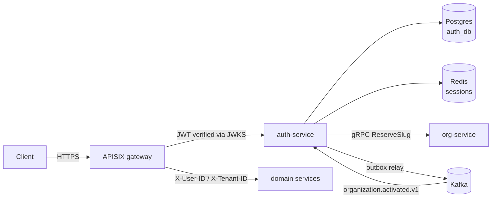

# auth-service

Authentication and session management for the mcsr platform. Multi-tenant,
one identity belongs to exactly one tenant.

| | |
|---|---|
| **Stack** | NestJS 11, TypeScript, TypeORM, Postgres, Redis, Kafka, gRPC |
| **Port** | `3001` (`APP_PORT`) |
| **Base path** | `/api/v1` — except `/healthz` and `/.well-known/jwks.json` |
| **Owns** | `identities`, `email_verifications`, `outbox_events`, `tenant_refs` (projection) |
| **Depends on** | Postgres, Redis, Kafka, org-service (gRPC) |

## Docs

| File | Contents |
|---|---|
| [`flows.md`](./flows.md) | Tenant registration, login, refresh, logout — step by step |
| [`api.md`](./api.md) | Endpoints, request/response shapes, error codes |
| [`security.md`](./security.md) | Token design, revocation, JWKS, key rotation runbook |
| [`operations.md`](./operations.md) | Config, Kafka topics, Redis keys, troubleshooting, known gaps |

## What this service does — and does not

**Does**

- Stores credentials (`identities`) and verifies passwords
- Issues and verifies ES256 JWTs, publishes public keys at `/.well-known/jwks.json`
- Manages refresh-token rotation with replay detection
- Revokes sessions through a per-user session-version counter
- Owns the tenant signup entry point, because it is the only service that
  touches a plaintext password

**Does not**

- Own organizations. Name, slug, tier, status and database credentials live in
  **org-service** (Go). auth-service keeps `tenant_refs`, a 4-column read-model
  projection, and treats it as a cache — never a source of truth.
- Provision anything. Creating a tenant database is a provisioning worker's job.
- Connect to a tenant database. Ever. It only talks to its own.
- Know a tenant's tier. That is deliberately absent from the JWT; see
  [`security.md`](./security.md).

If you find yourself adding a tenant business field to `tenant_refs`, or opening
a tenant DB connection here, the boundary has leaked.

## Architecture



The gateway verifies access tokens itself using JWKS, so a normal request never
reaches auth-service. Only login, refresh, logout and signup do.

## Quick start

```bash
# 1. Infrastructure (from repo root)
make up
make init-kafka-topic        # topics are NOT auto-created

# 2. Signing key — required, the service refuses to boot without it
node -e "
const {generateKeyPairSync,createHash}=require('node:crypto');
const {publicKey,privateKey}=generateKeyPairSync('ec',{namedCurve:'P-256',
  publicKeyEncoding:{type:'spki',format:'pem'},
  privateKeyEncoding:{type:'pkcs8',format:'pem'}});
const kid=createHash('sha256').update(publicKey).digest('base64url').slice(0,16);
const b64=p=>Buffer.from(p).toString('base64');
console.log('JWT_CURRENT_KID='+kid);
console.log('JWT_CURRENT_PRIVATE_KEY='+b64(privateKey));
console.log('JWT_CURRENT_PUBLIC_KEY='+b64(publicKey));
" >> .env.dev

# 3. Run
pnpm install
pnpm start:dev

# 4. Verify
curl localhost:3001/healthz                      # database + redis up
curl localhost:3001/.well-known/jwks.json        # your public key, no "d" field
```

A successful boot logs:

```
[NestApplication]  Nest application successfully started
[NestMicroservice] Nest microservice successfully started
[ConsumerGroup]    Consumer has joined the group
                   groupId: "auth-service-group-server"
                   memberAssignment: { "organization.activated.v1": [0,1,2], ... }
```

If the consumer line is missing, the Kafka consumer never subscribed — see
[`operations.md`](./operations.md#troubleshooting).

## Project layout

```
src/
├── auth/              Login, refresh, logout, tenant signup, JWT signing, JWKS
│   ├── constants/     Redis key builders, event names, TTLs
│   ├── interfaces/    UserJwtPayload, JwtKey, SessionData
│   └── services/      AuthService, TenantAuthService, JwtTokenService, SessionService
├── identity/          IdentityService — the only writer of `identities`
├── organization/      Boundary with org-service
│   ├── adapters/      gRPC adapter implementing OrganizationPort
│   ├── controllers/   Kafka @EventPattern handlers
│   ├── services/      TenantDirectoryService (read), OrganizationSyncService (write)
│   └── organization.port.ts   The interface domain code depends on
├── outbox/            OutboxRelayService — Postgres outbox -> Kafka
├── kafka/             ClientKafka producer registration
├── redis/             ioredis wrapper
├── entity/            TypeORM models
├── common/            Guards, decorators, interceptors, utils
└── config/            Per-environment config, JWT key loading
```

## Conventions worth knowing before you edit

**Domain code never imports from `organization/adapters/`.** `AuthService` and
`TenantAuthService` depend on `OrganizationPort` only, so the transport stays
swappable. Enforce it with:

```bash
grep -rn "adapters/" src/auth src/identity   # must print nothing
```

**Redis keys always carry the tenant first.** `AuthRedisKey` builds
`auth-service:<domain>:<tenantId>:<userId>` so the gateway's Redis ACL stays a
simple prefix match. Never build a key by hand.

**`identities` is keyed by an app-generated UUIDv7.** The id is created in
`TenantAuthService` before the gRPC call, so org-service can record the owner in
the same round trip — and the same UUID becomes the primary key of `core.users`
in the tenant database. Do not switch it to `@PrimaryGeneratedColumn`.

**Anything you want inside a JWT must live in auth's own database.** Login never
touches a tenant DB, so a claim sourced from tenant data cannot be signed.
