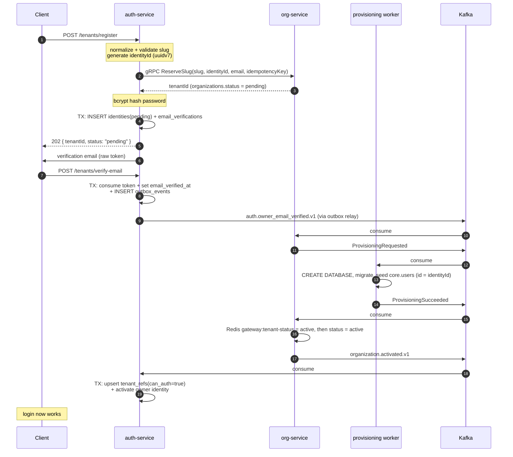
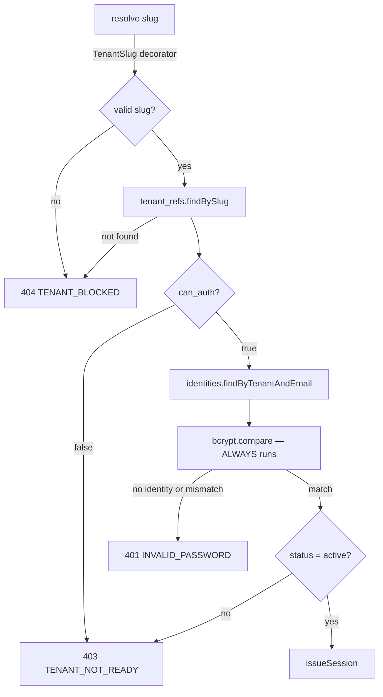
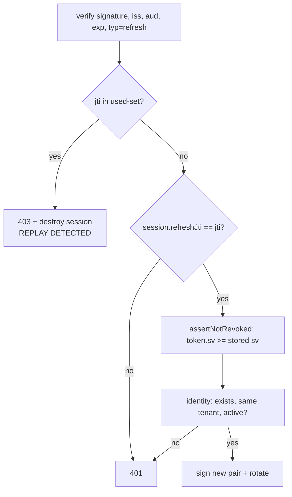

# Flows

## Tenant registration

Creating a tenant spans two services and a provisioning worker, and provisioning
cannot run inside a transaction (`CREATE DATABASE` is not transactional). So the
flow is asynchronous and **returns no tokens**.



### Why the order is what it is

**Slug is reserved before the password is hashed.** Slug collision is the common
failure and bcrypt costs ~100ms. Failing fast is worth more than the symmetry.

**Email verification gates provisioning.** Provisioning allocates an entire
database. Without that gate, one script gives you ten thousand databases. Here
email verification protects infrastructure, not inbox hygiene.

**The password is hashed in-process and never leaves.** It is not in the gRPC
call and not in any Kafka message — Kafka persists, replicates and retains
everything it carries. This is also why the signup endpoint lives in
auth-service rather than org-service: only one service should ever see a
plaintext password.

**No tokens in the 202.** The tenant database does not exist yet, so a token's
`tid` would point at nothing and every downstream call would fail confusingly.

**Redis is written before the status flip** (org-service side). The gateway fails
closed on a missing `gateway:tenant-status` key, so this order makes the gap
reject requests. Reversed, you get a window where the tenant is `active` with no
Redis key and every request 503s.

### Failure handling

| Failure | Behavior |
|---|---|
| Slug invalid / reserved | `400 SLUG_INVALID` / `SLUG_RESERVED`, nothing written |
| Slug already taken | `409 SLUG_TAKEN` |
| org-service unreachable | `503`, nothing written |
| Local TX fails | `releaseSlug(tenantId)` compensates, then the error is rethrown |
| **Duplicate signup (same slug + email)** | `202` with the same `tenantId` — see below |

The duplicate case is subtle and worth understanding before you touch
`TenantAuthService.register`:

`reserveSlug` is idempotent on `idempotencyKey = sha3_256(slug:email)`. A retry
therefore gets back the **same** `tenantId`, then collides on the
`(tenant_id, email)` unique index — Postgres error `23505`. That collision means
the *first* attempt already succeeded, so compensating would delete a live
organization. The handler returns success instead:

```ts
if ((error as { code?: string })?.code === '23505') {
  return { tenantId, status: 'pending' };
}
```

Because the idempotency key includes the email, org-service only replays the same
`tenantId` to the *same* person. A different email on the same slug produces a
different key and gets `SLUG_TAKEN`, so this can never hand someone another
tenant's workspace.

### The "not ready yet" window

Between the `202` and `organization.activated.v1`, the account exists but cannot
authenticate. This can last minutes. Login distinguishes it explicitly:
`TENANT_NOT_READY`, never `INVALID_PASSWORD`.

---

## Login

```
POST /api/v1/auth/login
Header: X-Tenant-Slug: acme   (or the subdomain acme.geomessage.com)
Body:   { email, password }
```



Three deliberate choices here, all about not leaking who has an account:

1. **An unknown email and a wrong password return the identical error.**
2. **bcrypt always runs**, against `DUMMY_PASSWORD_HASH` when the email is
   unknown, so the two cases take the same time. Without it, latency alone
   reveals which emails exist.
3. **The status check happens after the password check.** Checking first would
   confirm a pending account exists to someone who does not know its password.

A fourth, less obvious one: `TenantSlug` returns `undefined` for anything that is
not a well-formed slug, and both the decorator and `findBySlug` reject it.
TypeORM drops `undefined` from a `WHERE` clause, so `findOneBy({ slug: undefined })`
would return **the first row in the table** — i.e. log you into an arbitrary
tenant. Keep both guards.

`issueSession` reads the current session version, signs the pair with
`tid = identity.tenantId`, and stores `refreshJti` in Redis.

---

## Refresh

```
POST /api/v1/auth/refresh-token
Header: refresh-token: <token>
```

Guarded by `@RefreshOnly()`, which is what makes a refresh token usable *only*
here. `JwtTokenService.verify(token, 'refresh')` additionally rejects an access
token by its `typ` claim, so the restriction holds at both the route and the
token level.



**Replay detection is the important part.** Each refresh moves the old `jti` into
`refresh-token:used:<tenantId>:<userId>` and writes the new one into the session
hash. A `jti` that shows up twice means someone replayed a stolen token, so the
whole session is destroyed — which, because `logout` bumps the session version,
also kills the attacker's access token immediately rather than 15 minutes later.

The reuse check runs **before** the current-`jti` check on purpose: a replayed old
token fails both, and you want the session-kill path, not a generic 401.

---

## Logout and revocation

```ts
await this.sessionService.bumpSessionVersion(tenantId, userId);  // first
await this.sessionService.end(tenantId, userId);                 // then
```

The order matters. If the process dies between the two, you are left with a stale
session hash and a revoked counter — which fails closed. The other order fails
open.

`bumpSessionVersion` is `INCR` on
`auth-service:session-version:<tenantId>:<userId>`. Every token carries the value
it was signed with as `sv`; a token is revoked when `token.sv < stored sv`. An
absent key means `0`, i.e. never revoked.

This is a **per-user** counter, not per-device: logging out kills every device
that user is signed in on. Per-device logout would require the counter to be
keyed by session id instead, and that choice is baked into the token.

See [`security.md`](./security.md) for how the gateway enforces this on live
tokens.
